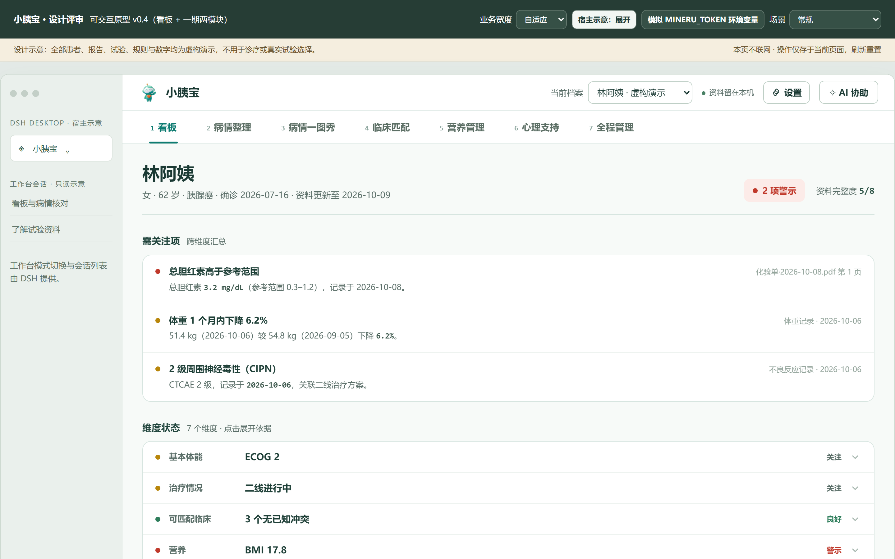

# 小胰宝社区版

> **胰腺癌患者全程管理工作台 · 社区发行版**
>
> 宿主基线：[DSH Desktop](https://dshdesktop.com/zh/)（MIT，改造而来）；[DSH Desktop Next](https://www.dshdesktop.cn/)（MIT，优选功能来源）；内嵌 [青囊 QingNang](https://github.com/PancrePal-xiaoyibao/QingNang)（Apache-2.0）医学能力包。
>
> ⚠️ **本软件是社区发行版，非 DeepSeek 官方产品，也与 DSH Desktop 官方团队无隶属关系。**
>
> ⚠️ **本工具不构成医疗建议**，不做诊断、不给用药剂量、不替代医生。涉及诊疗请以主治医生意见为准。遇到急症请立即就医。



> 上图是首页渲染：由本项目的 [交互原型](docs/prototype-v2.html)（设计权威）渲染而来 —— 界面就是按它实现的。

---

## 这是什么

一位胰腺癌患者的「病历 → 指标 → 趋势 → 决策依据」闭环工具。

**装完打开就是小胰宝**，不需要额外配置。数据默认保存在你自己的电脑上。

| 能做什么 | 说明 |
|---|---|
| **病历整理** | 导入化验单、病理、基因报告的 PDF 或照片，提取成结构化指标 |
| **报告核对** | 逐页确认机器读得对不对 —— **没经你确认的数据不会进趋势图** |
| **病情一图秀** | 关键指标与用药周期在同一条时间轴上对齐，一眼看出方案换后指标怎么变 |
| **看板** | 七个维度（体能 / 治疗 / 匹配 / 营养 / 心理 / 并发症 / 毒性）的状态一览 |
| **医学检索** | 内嵌青囊能力：查文献、查在招试验、查指南、搜网页（**5 条通道免凭据**） |
| **病历脱敏** | 内嵌脱敏技能，导出或分享前可先把个人信息打码 |

**不能做什么**（这些是刻意的边界）：

- ❌ 不诊断、不给用药剂量、不替代医生
- ❌ 不解读量表得分（只按官方分界呈现）
- ❌ 不做入组资格判定（只把入组标准逐条对照给你看）
- ❌ 不会主动提醒你（一期不做推送）

---

## 平台支持

| 平台 | 支持 |
|---|---|
| macOS（Apple Silicon / Intel） | ✅ |
| Windows（x64） | ✅ |
| Linux | ❌ 不支持 |
| 手机 / 平板 | ❌ 不在本期范围 |

---

## 下载与安装

从**社区发布页**下载对应平台的产物，并用 `version-index.json` 里的 SHA-256 校验（可选但推荐）。

**每个平台都有两种：**

| 平台 | 安装版 | 免安装版 |
|---|---|---|
| macOS（Apple Silicon / Intel） | `xyb-desktop-community-<版本>-mac-<arch>.dmg` | `xyb-desktop-community-<版本>-mac-<arch>.zip` |
| Windows x64 | `xyb-desktop-community-<版本>-windows-x64-setup.exe` | `xyb-desktop-community-<版本>-windows-x64-portable.zip` |

**安装版**：写注册表 / 建快捷方式，随系统卸载；**免安装版**：解压即用，不写注册表也不建快捷方式
（适合放 U 盘或共享盘）。**两者数据完全一致**（都保存在本机应用数据目录），可以互相对着用；
换版不会丢数据，也不会重复占用。

### macOS

1. 下载 `xyb-desktop-community-<版本>-mac-<arch>.dmg`
2. 双击打开，把「小胰宝社区版」拖进「应用程序」
3. **若提示「无法打开，因为来自身份不明的开发者」**：
   - 打开「系统设置 → 隐私与安全性」，在底部找到被拦截的提示，点「仍要打开」
   - 或者：右键点应用图标 → 「打开」→ 在弹窗里再点「打开」
   - 这是**未签名版本**的正常表现（正式签名版需要开发者证书，见下文「已知限制」）

### macOS（免安装）

1. 下载 `xyb-desktop-community-<版本>-mac-<arch>.zip` 并解压
2. 把解压出来的「小胰宝社区版.app」拖到任意位置（例如「应用程序」或桌面）
3. 第一次打开若被拦截，按上面的「仍要打开」步骤处理；也可在终端执行：
   `xattr -dr com.apple.quarantine "/路径/小胰宝社区版.app"`

### Windows（安装版）

1. 下载 `xyb-desktop-community-<版本>-windows-x64-setup.exe`
2. 双击运行
3. **若出现 SmartScreen 蓝色提示「Windows 已保护你的电脑」**：
   - 点「更多信息」→「仍要运行」
   - 这是**未签名版本**的正常表现

### 首次使用

打开后直接进入小胰宝工作台（完整面板）：

- **首屏即面板**：顶栏（当前档案 / 资料留在本机 / AI 协助 / 设置）+ 七个页签
- **没有患者档案时**：给出建立档案入口，七项指标全标「未上传」（不会用 0 或空白冒充）
- **已可用（真数据）**：看板（需关注项/维度状态/全程管理）、病情整理（资料库/报告核对/指标趋势/病情评估/病情汇总）、病情一图秀（指标与用药同轴）、心理支持（四子页 + 危机热线）、全程管理（四类状态）、设置
- **部分可用（真实部分 + 诚实声明）**：临床匹配（入组档案为真数据；检索/分析/收藏/渠道归 ）、营养（体重为真数据；能量/摄入/胰酶剂量边界归 与医学红线）
- **聊天**：右侧「AI 协助」面板；点「新建工作区并开始对话」创建会话后，会话（由宿主提供）就嵌在该面板里

### Windows（免安装）

1. 下载 `xyb-desktop-community-<版本>-windows-x64-portable.zip` 并解压到**任意目录**
   （建议不要解压到 `C:\Program Files` 这类受保护目录 —— 那可能触发权限拦截）
2. 双击解压目录里的 `小胰宝社区版.exe` 即可运行
3. 若出现 SmartScreen 提示，点「更多信息」→「仍要运行」

> 免安装版**不会**写注册表、不会建快捷方式，删除整个目录即可；数据在应用数据目录里，
> 想彻底清除需另外删除数据目录（设置页「数据自检 / 关于」会显示它的位置）。

> 未实现的能力一律写明归属里程碑，**不铺演示数据**（例：带管/血管通路标 ）。

数据保存在你的电脑上（具体位置见 [数据在哪](#数据在哪)）。

---

## 数据在哪

**默认完全保存在本机**，不上传。

| 内容 | 位置 |
|---|---|
| 小胰宝业务数据（患者档案、指标、用药、文档） | 应用数据目录下的 `xyb/` 子目录 |
| 青囊私有数据（你自己的笔记等） | `~/.qingnang/private/`（权限 0700） |
| MinerU Token（若配置） | `~/.mineru/config.yaml`（与 MinerU 命令行共用） |

> 具体路径可在「设置」里看到。

详见 [`docs/PRIVACY.md`](docs/PRIVACY.md) 与 [`docs/DATA-SOVEREIGNTY.md`](docs/DATA-SOVEREIGNTY.md)。

### 什么时候会联网

**只有两种情况**：

1. **你用青囊检索时**（查文献 / 试验 / 网页）—— 网络请求**只带检索词**，不带患者信息
2. **你显式开启云端解析后**（把扫描件上传给 MinerU 解析）—— 只上传**你选中的那个文件本身**，不上传档案、记录、笔记

除这两种情况，程序不发起任何网络请求。

---

## 青囊能力（内嵌）

青囊是社区维护的医学能力资产包，本发行版已**内嵌并自动注册**，装完即用。

| 通道 | 能力 | 凭据 |
|---|---|---|
| 通用网页搜索 | 搜索网页内容 | 免凭据 || 中文网页搜索 | 中文内容搜索 | 免凭据 |
| 医学文献检索 | PubMed | 免凭据 |
| 学术文献（开放获取） | OpenAlex | 免凭据 |
| 临床试验检索 | 统一试验检索 | 免凭据 |
| 高级医学证据 | KnowS | **需凭据**（未配时明示未启用，并降级到文献通道） |
| 病友经验 | 得到笔记 | **需凭据**（未配时**明示未启用**，不拿网页冒充） |

在「设置 → 检索通道（青囊 MCP）」可看到每条通道的状态（已启用 / 未配凭据 / 失败）、**这条通道需要哪个凭据名**、已装载的技能清单，并可重新体检。

需要凭据的通道（凭据由社区申请发放）**直接在同一个设置页里填 Key 即可**：保存后写入本机凭据文件、立即按新凭据重建通道，不需要重启；界面上只显示「已配置 / 来源（本机设置 / 环境变量）」，**永不回显 Key 本身**。

**搜索失败先看什么**：青囊会在首次启动时生成一份「本机画像」（含本机建议使用的代理地址）。如果你在国内且搜不到境外内容，通常需要配置代理 —— 画像里会告诉你该填什么。

---

## 配置模型与 API Key

顶栏「设置 → 模型与 API Key」是一个**下拉式**面板：先选提供方，再填这一家的 Key（不会把所有提供方摊开）。

- **用现成提供方**：下拉里选（如 DeepSeek 官方）→ 填 Key → 保存。服务地址与协议由宿主给出，界面上只显示、不改。
- **用自定义提供方**：下拉最后一项「自定提供方…」，需要填 5 项 —— 标识（小写字母+连字符）、显示名、协议、服务地址、Key，外加模型 id。地址规范：
  - OpenAI 兼容：写到版本段，例如 `https://api.openai.com/v1`（探测会拼 `/models`）
  - Anthropic：写到版本段，例如 `https://api.anthropic.com/v1`（探测会拼 `/v1/models`）
- **选右侧 AI 栏用的模型**：「右侧 AI 栏使用的模型」区域点「刷新可用模型」，**只列出接口返回 200 的模型**（用不了的不展示），每项显示「模型名 · 供应商名」；选中后点「设为当前模型」。
  没配 Key 时不会去探测，界面会提示先填 Key。

所有 Key 写入**宿主自己的凭据存储**（与宿主设置面板同一份），本工作台不留副本；界面上只显示「已配置 / 未配置 / 来源」，**永不回显 Key 本身**。

## 升级

1. 下载新版本安装包
2. 直接安装覆盖（**不需要先卸载**）
3. 你的数据会保留（数据在独立目录，不在应用安装目录里）

**升级前建议先备份**（见下）。

## 备份

一期备份方式：**手动复制数据目录**（设置页可看到具体路径）。

> 一键备份与还原功能在开发计划中。

---

## 隐私与合规

| 文档 | 内容 |
|---|---|
| [`docs/PRIVACY.md`](docs/PRIVACY.md) | 数据在哪、何时联网、联网传什么 |
| [`docs/DATA-SOVEREIGNTY.md`](docs/DATA-SOVEREIGNTY.md) | 数据主权、无账号、备份与迁移 |
| [`docs/MEDICAL-DISCLAIMER.md`](docs/MEDICAL-DISCLAIMER.md) | 完整医疗免责声明（六条红线） |
| [`docs/KNOWN-LIMITATIONS.md`](docs/KNOWN-LIMITATIONS.md) | 已知限制（未签名、平台、功能边界） |
| [`docs/FAQ.md`](docs/FAQ.md) | 常见问题 |
| [`LICENSE`](LICENSE) | 本发行版许可（MIT）+ 上游与青囊归属 |
| [`THIRD-PARTY-NOTICES.md`](THIRD-PARTY-NOTICES.md) | 第三方组件与许可清单 |

---

## 给开发者

### 仓库结构

```
packages/
  dsh-xyb-branding/ 品牌层（双 logo）
  dsh-xyb-workbench/ 业务层（小胰宝工作台）
  dsh-xyb-qingnang/ 能力层（青囊嵌入）
<!-- PUBLIC-STRIP:START -->
vendor/dsh-desktop-main/ 宿主源码（受控改造）
vendor/dsh-desktop-next/ 上游源码（比对与优选来源）
tasks/ 立项与验收档案
agent-reference/ 开发工具文档
<!-- PUBLIC-STRIP:END -->
scripts/ 构建与检查脚本
test/ 静态检查 + 契约 + 数据层 + 运行时测试
docs/ 用户文档与交互原型
```

> **上游项目来源**（两个，各自独立开源、与本项目无隶属关系）：
> 1. [DSH Desktop Next](https://github.com/anywhere-labs/dsh-desktop)（Anywhere Labs，MIT）
> 2. [DSH Desktop](https://dshdesktop.com/zh/)（DataElement，MIT）—— 本发行版的宿主基线
>
> 本项目**不镜像**它们的源码：构建时按锁定 commit 取回（见
> [`UPSTREAM-SOURCES.md`](UPSTREAM-SOURCES.md)），第三方版权与许可见 [`THIRD-PARTY-NOTICES.md`](THIRD-PARTY-NOTICES.md)。

### 本地开发

```bash
# 检查套件（全绿才提交）
node scripts/check-syntax.mjs
node scripts/check-plugin-contract.mjs
node scripts/check-vendor-modifications.mjs
node scripts/check-sanitization.mjs
node scripts/check-copy-compliance.mjs
node scripts/check-ui-tokens.mjs
bash scripts/test-parallel.sh

# ── 仅开发仓（公开仓没有宿主源码，无法构建安装包）
node scripts/prepare-vendor-plugins.mjs # 打包与 dev 运行前就位插件；npm ci 后需重跑
npm run package:win # 产出安装包与免安装包（需 vendor/）
```

> 公开仓里 `check-vendor-modifications` 会**显式跳过**（标注「不适用」），
> 因为上游源码不在这里；其余检查与测试照常执行。

### 工程约定

- 客户端代码必须是宿主 `__ModuleLoader__` 形态（**零 import、零 JSX、无构建步骤**）
- **不得修改宿主核心运行时逻辑**（只允许配置 / 资产 / 插件注册 / 打包参数四类改造）
<!-- PUBLIC-STRIP:START -->
- 每项 vendor 改造必须记入 
<!-- PUBLIC-STRIP:END -->
- 每项宿主改造都必须有记录与回退方案（改造清单保存在开发仓；公开仓只保留结论）
- 医学安全六条红线与数据可信机制（人工闸门 / 方向语义）不得破坏

维护、开发与发行流程（含两仓模型与同步脚本）见 [`docs/MAINTENANCE.md`](docs/MAINTENANCE.md)。

<!-- PUBLIC-STRIP:START -->
开发仓的内部规范见 `AGENTS.md`（含踩坑记录与硬门控）。
<!-- PUBLIC-STRIP:END -->

---

## 许可

- 本发行版：**MIT**
- 上游 DSH Desktop（我们改造的宿主基线）：**MIT**（Copyright (c) 2026 DataElement）
- 上游 DSH Desktop Next：**MIT**（Copyright (c) 2026 Anywhere Labs）
- 共同上游 DeepSeek Harness：**MIT**（Copyright (c) 2026 DeepSeek）
- 青囊 QingNang：**Apache-2.0**
- 青囊内嵌的 10 个技能与 7 个 MCP 服务：各自许可，见 [`THIRD-PARTY-NOTICES.md`](THIRD-PARTY-NOTICES.md)

上游许可证原文完整保留，未作修改。

---

## 致谢

### 感谢 dataelement 团队

本发行版能够存在，首先归功于 **[dataelement 团队](https://github.com/dataelement)** 的工作 —— 他们维护的 **[DSH Desktop](https://dshdesktop.com/zh/)** 是本发行版的**宿主基线**。

感谢你们：

- **把一套成熟的 Electron 宿主做成了可扩展的插件平台**。工作台注册、slots 注入、Profile 隔离、补丁机制——这些设计让我们能用「配置 + 插件」的方式完成改造，而不是重写宿主。整个项目对上游的改动只有 8 项，且**全部落在配置与资产层**，没有一行核心运行时逻辑被改。
- **选择了 MIT 许可**。这让我们可以在保留完整版权声明的前提下，为胰腺癌患者社区做一个开箱即用的发行版。
- **把工程规范写进了仓库**。`AGENTS.md`、`workbench-standard.zh.md`、`release-runbook.md`——这些文档把「怎么正确扩展」「怎么安全发布」讲得很清楚，直接成了我们的工程依据。
- **把 CI/CD 做扎实了**。我们的发布流水线（目标平台构建、安装 smoke、版本索引）大量参照了上游 `release.yml` 的实测参数与阶段划分。
- **在实现里留下了可读的注释**。`dsh-desktop-workbenches`、`dsh-desktop-client-ui`、`dsh-image-generation` 这几个包是我们的主要参考实现；那些解释「为什么这么写」的注释，帮我们避开了不少坑。

我们也把上游的踩坑经验固化成了自己的检查脚本（见 [`CONTRIBUTING.md`](CONTRIBUTING.md) 的踩坑表与 `scripts/check-plugin-contract.mjs`），并以 `patches/host-modifications.patch` + `patches/host-modifications.manifest.json` 逐项记录对宿主的改造（可逐文件 sha256 对账）——**希望能长期跟住上游，而不是分叉跑掉**。

### 上游项目参考

本发行版的**宿主基线**是 **[DSH Desktop](https://github.com/dataelement/dsh-desktop)**（DataElement，MIT）；
我们也参考了 **[DSH Desktop Next](https://github.com/anywhere-labs/dsh-desktop)**（Anywhere Labs，MIT）
在桌面工程上的一些做法，并择优移植了部分子系统（按许可要求逐项登记在
[`THIRD-PARTY-NOTICES.md`](THIRD-PARTY-NOTICES.md)）。

- **「一切皆插件」的边界判断**：他们的桌面壳本身就是一个 DSH 插件，与我们「工作台即插件」的判断一致。
- **桌面稳定性工程**：启动恢复、数据目录治理、诊断导出、日志历史 —— 这些是商业桌面软件区别于「能跑的 demo」的地方。
- **工程门禁脚本化**：双语文档校验、依赖方向门、并行测试 runner，与我们 `scripts/check-*.mjs` 的思路一致。

两个上游项目与本项目**没有隶属或从属关系**；各自版权与许可、以及我们移植了什么，均见
[`THIRD-PARTY-NOTICES.md`](THIRD-PARTY-NOTICES.md)；上游的锁定版本与取回方式见
[`UPSTREAM-SOURCES.md`](UPSTREAM-SOURCES.md)。

### 青囊：本项目的医学能力层（也是我们对社区的技术栈建议）

本发行版的医学能力来自 **[青囊 QingNang](https://github.com/PancrePal-xiaoyibao/QingNang)** ——
它是**小胰宝社区自己的开源项目**（Apache-2.0），提供 5 条免凭据检索通道、11 个技能
（含 2 个病历脱敏）以及三条写在注入层里的红线（不诊断 / 不给剂量 / 遇急症先就医）。

它从设计上就按「**可被嵌入**」做的：`MANIFEST.json` 里预留了 `forge_seams` 接缝，并直接
提供 `--format=dsh` 的配置输出 —— 所以把它接进 DSH 宿主，工作从「改造」变成了「对接」。

**欢迎其他开发者也走这条路。** 如果你想让自己的 agent 具备医学生命科学相关能力
（文献 / 在招试验 / 指南 / 脱敏 / 通道编排，以及避开诊断与剂量这类合规边界），
可以直接把青囊当作技术栈接进去，不必从零写通道与边界：

> 青囊仓库：<https://github.com/PancrePal-xiaoyibao/QingNang>

（青囊自身内嵌了 10 个技能与 7 个 MCP 服务，来自 `opencare-skillhub` 等社区项目；
它们各自的许可与来源见 [`THIRD-PARTY-NOTICES.md`](THIRD-PARTY-NOTICES.md)。）

### 感谢每一位内测成员

你们在没有签名、没有自动更新的版本上帮我们踩坑，这份耐心比代码更珍贵。

---

## 社区

- 青囊仓库：https://github.com/PancrePal-xiaoyibao/QingNang
- 本发行版仓库：https://github.com/PancrePal-xiaoyibao/dsh-desktop-xiaoyibao
- 上游 DSH Desktop（宿主基线）：https://github.com/dataelement/dsh-desktop
- 上游 DSH Desktop Next：https://www.dshdesktop.cn/ ｜ https://github.com/anywhere-labs/dsh-desktop
